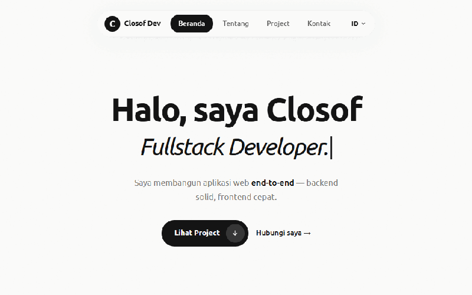
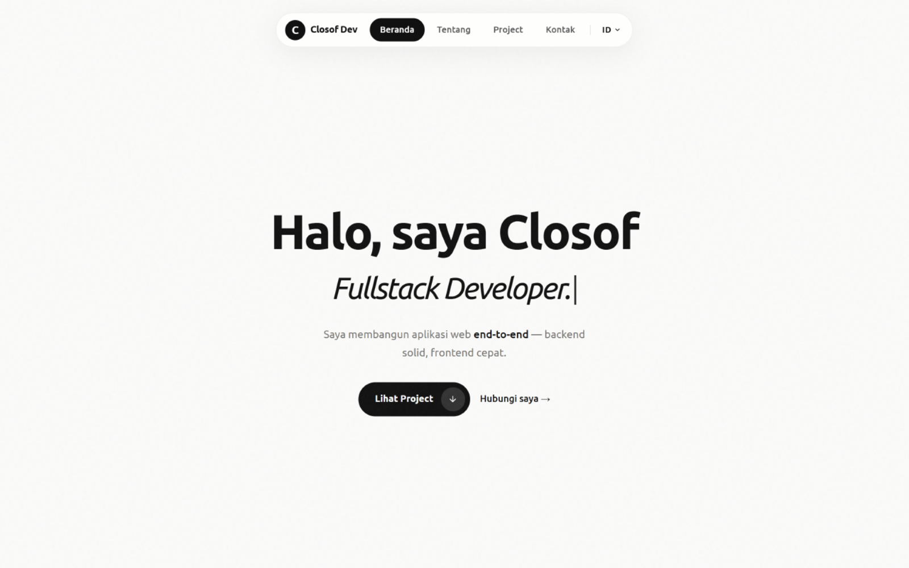
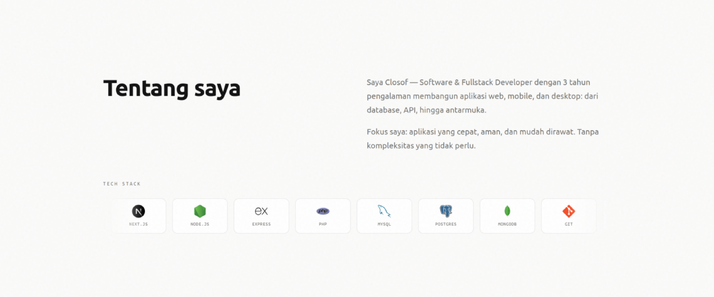
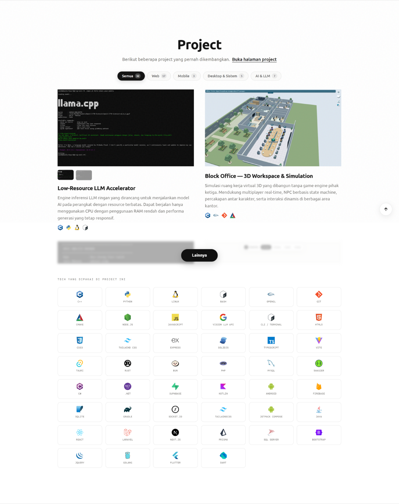
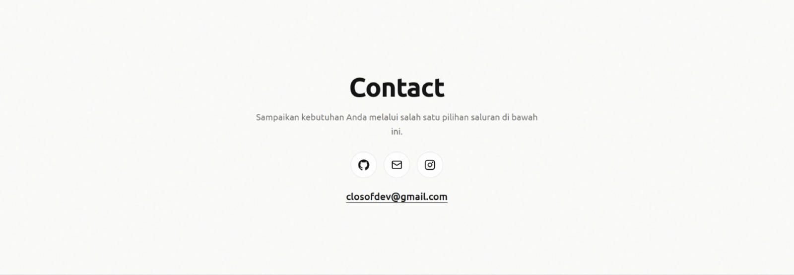
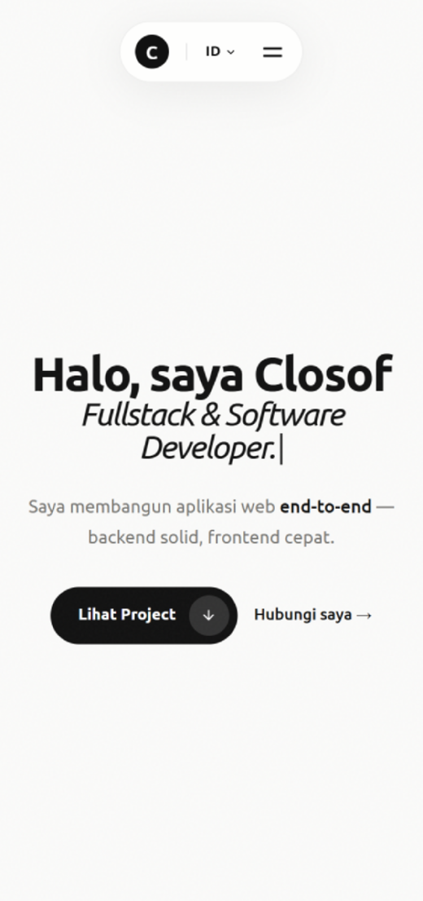
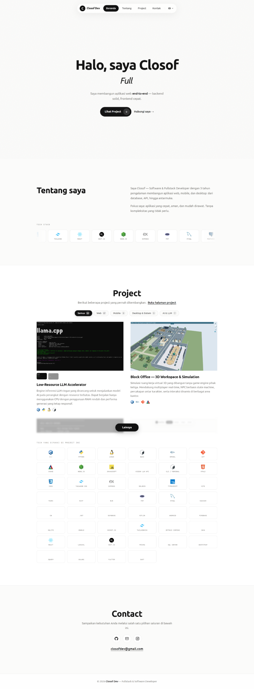

# Closof — Portfolio Website

Website portofolio satu halaman untuk menampilkan project web, mobile, desktop, dan AI. Dibuat tanpa framework dan tanpa proses build: satu file HTML, satu stylesheet, satu script.

**Live:** https://www.closof.site



---

## Preview

| Beranda | Tentang |
| --- | --- |
|  |  |

| Project | Kontak |
| --- | --- |
|  |  |

| Tampilan mobile | Halaman penuh |
| --- | --- |
|  |  |

---

## Fitur

Semua fitur di bawah ini benar-benar ada di dalam kode, bukan sekadar daftar.

- **Bilingual ID/EN** — seluruh teks, judul halaman, dan meta description berganti bahasa. Pilihan bahasa disimpan di `localStorage`, dan lebar navbar dianimasikan (`morphIslandNav`) saat teks berganti agar tidak ada lompatan layout.
- **Filter kategori project** — tab `Semua / Web / Mobile / Desktop & Sistem / AI & LLM`. Jumlah tiap tab dihitung otomatis dari data project, bukan ditulis manual.
- **Grid project bertahap** — hanya 2 kartu tampil pertama, sisanya dibuka lewat tombol "Lainnya" dengan transisi tinggi + blur dan auto-scroll ke kartu terakhir.
- **Multi-foto per project** — project dengan beberapa gambar punya baris thumbnail. Perpindahan gambar pakai crossfade + morph tinggi (`smoothSwitchProjectImage`) supaya rasio gambar yang berbeda tetap mulus.
- **Animasi mengetik di hero** — daftar kata berganti dengan kecepatan ketik/hapus yang berbeda dan jeda baca.
- **Marquee tech stack** — deretan ikon teknologi bergerak terus-menerus (isi diduplikasi di JS agar loop mulus).
- **Smooth scroll khusus navigasi** — klik navbar/anchor memakai easing sendiri; scroll manual (wheel/touch) langsung membatalkan animasi.
- **Copy email + toast** — tombol salin email dengan fallback `execCommand` untuk browser tanpa Clipboard API.
- **Navbar auto-hide** — sembunyi saat scroll ke bawah, muncul saat scroll ke atas, dan selalu tampil ketika menu mobile terbuka.
- **Responsif & aksesibel** — layout menyesuaikan dari mobile sampai desktop, dan animasi dinonaktifkan saat `prefers-reduced-motion` aktif.

---

## Struktur

```
.
├── index.html          # Markup halaman + konfigurasi Tailwind (CDN)
├── style.css           # Seluruh styling kustom
├── script.js           # Data project, i18n, render, dan semua interaksi
├── closof-logo.png     # Logo / favicon
└── media/              # Screenshot project + gambar preview README
    └── preview/        # Aset yang dipakai README ini
```

## Menjalankan

Tidak ada dependency atau build step. Cukup buka `index.html` di browser:

```bash
# langsung
start index.html        # Windows
open index.html         # macOS

# atau lewat server lokal agar path relatif & gambar berjalan normal
python -m http.server 8080
```

## Menambah atau Mengubah Project

Semua data project berada di satu array `PROJECTS` di bagian atas `script.js`. Tambahkan objek baru:

```js
{
  title: 'Nama Project',
  category: 'web',            // web | mobile | desktop | ai
  image: 'media/nama-file.png',
  images: ['a.png', 'b.png'], // opsional, untuk thumbnail multi-foto
  fit: 'cover',               // opsional: 'cover' (penuh frame) atau 'contain'
  desc: 'Deskripsi bahasa Indonesia.',
  desc_en: 'English description.',   // opsional
  demo: null,                 // isi URL untuk memunculkan tombol "Lihat Disini"
  github: null,               // isi URL untuk memunculkan tombol "Lihat github"
  tech: [
    { name: 'React', icon: 'https://cdn.jsdelivr.net/gh/devicons/devicon/icons/react/react-original.svg' },
  ],
}
```

Jumlah kartu, isi filter, dan daftar tech di bagian bawah halaman ikut ter-update otomatis dari array ini.

## Tech

- HTML5 + Tailwind CSS (via CDN)
- JavaScript (vanilla, tanpa framework)
- Google Fonts (Ubuntu, Ubuntu Mono)
- Devicon untuk ikon teknologi

## Video

Animasi di atas ditampilkan sebagai GIF karena README GitHub tidak merender tag `<video>`. Rekaman layar kualitas penuh (1280×800, 30fps, 8 detik) tersedia sebagai file di repo:

- [`media/preview/preview.mp4`](media/preview/preview.mp4) — H.264, kompatibel luas (3.3 MB)
- [`media/preview/preview.webm`](media/preview/preview.webm) — VP9, ukuran lebih kecil (2.5 MB)

Cara menonton:

```bash
# buka langsung, atau
start media/preview/preview.mp4     # Windows
open media/preview/preview.mp4      # macOS
```

> Video ini direkam dari halaman live https://www.closof.site, jadi menampilkan perilaku asli (termasuk animasi mengetik di hero).

---

Dibuat dan dirawat oleh [Closof](https://github.com/closofdev).
